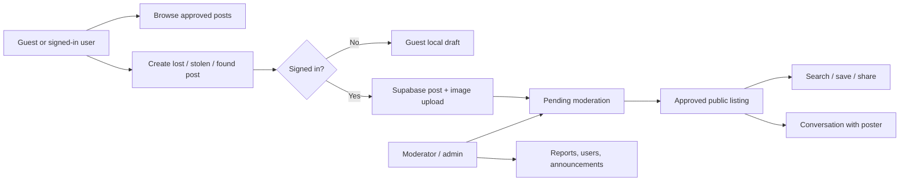

<p align="center">
  
</p>

<h1 align="center">Find</h1>

<p align="center">
  A Kurdish Sorani, RTL-first public-service app for reporting <strong>lost</strong>, <strong>stolen</strong>, and <strong>found</strong> items across Kurdistan / Iraq.
</p>

<p align="center">
  <a href="https://flutter.dev"></a>
  <a href="https://dart.dev"></a>
  <a href="https://supabase.com"></a>
  
  
</p>

<p align="center">
  <em>دۆزینەوەی شتە ونبووەکان بە ئاسانی</em>
</p>

---

## Why Find exists

When people lose something important, the hardest part is often not searching — it is reaching the right community quickly, safely, and in a language that feels native. **Find** is built to make that moment less chaotic: publish a report, discover matching items, contact the poster, and let moderators keep the public space trustworthy.

## Highlights

| Public experience | Trust & moderation | Product craft |
| --- | --- | --- |
| Lost / stolen / found posts | GitHub OAuth authentication | Kurdish Sorani interface |
| Search, categories, urgent items | Admin dashboard and approvals | RTL-first layouts |
| Saved posts and notifications | Reports and abuse handling | Material 3 + Cupertino-aware styling |
| Direct conversations | Row Level Security policies | Light and dark themes |
| Guest browsing mode | Storage rules for uploaded images | Mobile deep links |

## App flow



## Tech stack

| Layer | Tools |
| --- | --- |
| App | Flutter, Dart, Material 3 |
| State & navigation | Riverpod 3, GoRouter |
| Backend | Supabase Auth, PostgreSQL, Storage |
| UX helpers | Cached network images, local notifications, connectivity, sharing |
| Localization posture | Kurdish Sorani copy, RTL-first composition |

## Core features

- Publish lost, stolen, and found item reports with images, category, city, date, and contact controls.
- Browse urgent and recent posts from a public home feed.
- Search by keyword and filter by post type.
- Save posts, manage personal posts, and receive notifications.
- Message posters through authenticated conversations.
- Moderate approvals, reports, users, and public announcements from an admin dashboard.
- Keep guest users useful without exposing private account features.

## Project structure

```text
lib/
  app/                  app shell, routing, theme, localization
  core/                 constants, services, validation, utilities
  shared/               models and reusable widgets
  features/
    admin/
    auth/
    home/
    messages/
    notifications/
    onboarding/
    posts/
    profile/
    search/
    settings/
    static_pages/
supabase/
  migrations/           schema, indexes, triggers, RLS, storage policies
docs/
  supabase_setup.md     backend setup guide
```

## Quick start

### 1. Clone the repository

```bash
git clone https://github.com/emberrenewed/find.git
cd find
```

### 2. Install dependencies

```bash
flutter pub get
```

### 3. Create your environment file

```env
SUPABASE_URL=https://your-project-ref.supabase.co
SUPABASE_ANON_KEY=your-public-anon-key
```

> Keep service-role keys out of the Flutter app. Only the public anon key belongs here.

### 4. Configure Supabase

Run the initial migration:

```bash
supabase link --project-ref your-project-ref
supabase db push
```

Then enable GitHub OAuth and add this mobile redirect URL:

```text
krd.gov.find.find://login-callback
```

For the full backend walkthrough, see [`docs/supabase_setup.md`](docs/supabase_setup.md).

### 5. Run the app

```bash
flutter run
```

## Security model

The initial migration creates:

- profile, post, image, conversation, message, saved-post, report, notification, and category tables
- helper functions and triggers
- search indexes
- Row Level Security policies
- the public `post-images` storage bucket

The policy model keeps the public side open enough to browse approved posts while reserving post approval, report review, announcements, and account moderation for trusted roles.

## Deep links

| Platform | Scheme |
| --- | --- |
| Android | `krd.gov.find.find://login-callback` |
| iOS | `krd.gov.find.find://login-callback` |

## Admin bootstrap

After the first GitHub login, promote the first administrator in Supabase:

```sql
update public.profiles
set role = 'admin'
where github_username = 'your-github-username';
```

## Current status

- [x] Core navigation and shell
- [x] Kurdish Sorani UI copy
- [x] Posting, browsing, search, messaging, saved posts
- [x] Supabase schema and RLS
- [x] Admin approval and reporting tools
- [ ] App store release preparation
- [ ] Production analytics and crash monitoring

## Suggested next upgrades

- Add screenshot gallery and a short product demo GIF.
- Add CI for `flutter analyze` and tests.
- Add multilingual support while keeping Sorani as the first-class experience.
- Add map-assisted location search for item reports.

## Repository note

This project intentionally keeps secrets out of version control:

- `.env` is ignored
- build output is ignored
- Android local machine settings are ignored

## Project health

- Continuous integration runs Flutter formatting checks, static analysis, and tests on every push and pull request.
- Contribution guidance lives in [`CONTRIBUTING.md`](CONTRIBUTING.md).
- Security reporting guidance lives in [`SECURITY.md`](SECURITY.md).
- Community expectations live in [`CODE_OF_CONDUCT.md`](CODE_OF_CONDUCT.md).
- Release notes are tracked in [`CHANGELOG.md`](CHANGELOG.md).

---

<p align="center">
  Built to help lost things find their way home.
</p>
